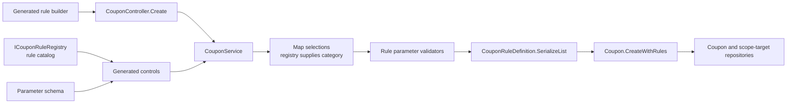
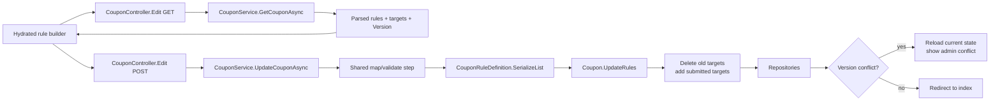

# Coupon rule authoring flow

The coupon rule builder is the only supported UI authoring surface for `RulesJson`. The browser posts typed rule selections and parameters; it never supplies rule categories as an authority and it never authors raw JSON.

## Create flow

`GetRuleCatalog()` projects the registry descriptors and parameter schemas into the builder catalog. Display text is supplied by the Web presentation layer. On submit, `CouponService` maps names through the registry, validates parameters, serializes the canonical rule list, and lets the aggregate validate scope/discount composition and target consistency before persistence.

## Edit flow

Edit round-trips the loaded `Coupon.Version` in a hidden Base64 field. A stale version returns an explicit concurrency conflict and the form is re-rendered with the current stored state. Scope targets are reconciled as a set: changing scope or target cannot leave orphaned rows or append a stale target.

## Internal boundary

- `ICouponRuleRegistry` owns rule names and categories.
- `ICouponRuleParameterSchema` describes builder inputs; `ICouponRuleParameterValidator` remains the server-side authority.
- `CouponRuleDefinition.ParseList` and `SerializeList` own the persisted wire format, including legacy numeric category compatibility.
- `RulesJson` is internal storage and evaluation data, not a Web form contract.
