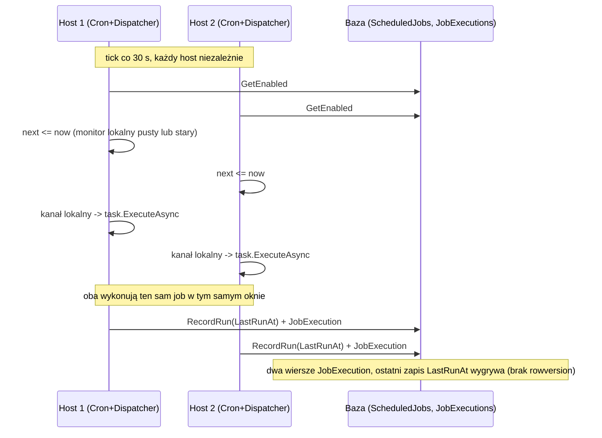

# Koordynacja zadań cyklicznych (cron) przy wielu hostach - nota decyzyjna

Data: 2026-10-18. Status: propozycja do decyzji, bez implementacji.

Kontekst: produkcja działa na 2 lub więcej hostach (do 5) współdzielących jedną bazę danych. Poniżej opis, jak
działa dziś planowanie zadań cyklicznych (`IScheduledTask` + `ScheduledJob`), co się dzieje przy N hostach, które
joby są na to odporne, jakie są opcje i rekomendacja. Wszystko wynika z czytania kodu; niczego nie uruchamiałem.
Czego nie sprawdzałem, jest wymienione na końcu.

## 1. Jak to działa dziś

Wszystkie trzy usługi są `BackgroundService` w `ECommerceApp.Infrastructure/Supporting/TimeManagement/` i są
rejestrowane w każdym hoście (`Extensions.cs`, `AddHostedService`). Kanał `JobTriggerChannel` i monitor
`InMemoryJobStatusMonitor` są singletonami w obrębie procesu.

**CronSchedulerService**
- Budzi się co 30 s, wyrównany do pełnych 30 sekund zegara (`ComputeAlignmentDelay`).
- W każdym ticku czyta z bazy wszystkie włączone `ScheduledJob` (`GetEnabledAsync`).
- Dla każdego joba wylicza `lastRun = monitor.GetLatest(name)?.CompletedAt ?? job.LastRunAt ?? now - 30 s`,
  potem `next = cron.GetNextOccurrence(lastRun, tz)`. Jeśli `next <= now`, zapisuje `JobTriggerRequest`
  (`Source = Scheduled`) do kanału.
- Nie zapisuje niczego do bazy i nie zna pojęcia "ten cykl już odpalony". Jedyną pamięcią jest monitor w pamięci
  procesu oraz `LastRunAt` ustawiane dopiero po zakończeniu joba.

**JobTriggerService** (`IJobTrigger`)
- Ręczne wyzwolenie: sprawdza, że `ScheduledJob` o danej nazwie istnieje, i pisze `JobTriggerRequest`
  (`Source = Manual`) do kanału lokalnego hosta, który przyjął żądanie HTTP. Nie ma koordynacji między hostami;
  ręczny trigger wykona się dokładnie na tym hoście, i to jest poprawne zachowanie.

**JobDispatcherService**
- Jedyny czytelnik kanału (`SingleReader = true`), przetwarza triggery sekwencyjnie.
- Szuka `IScheduledTask` po `TaskName`, wykonuje go, mierzy wynik, a w `PersistResultAsync` zapisuje: `RecordRun`
  (`LastRunAt`, `NextRunAt`) na `ScheduledJob` dla źródeł innych niż `Deferred`, oraz wiersz `JobExecution`
  (audyt, tylko dopisywanie). Dla `Deferred` usuwa lub oznacza porażką wiersz kolejki.
- Błąd zapisu wyniku jest tylko logowany.

**DeferredJobPollerService** (poza zakresem, ale ważny punkt odniesienia)
- Zadania jednorazowe (deferred) mają już atomowy lease: `TryAcquireLeaseAsync` to pojedynczy warunkowy
  `UPDATE ... WHERE Id = @id AND (Pending i RunAt <= now LUB Running i LockExpiresAt < now)` przez
  `ExecuteUpdateAsync`. Przegrany host dostaje 0 wierszy i pomija zadanie (ADR-0009,
  `docs/adr/0009/deferred-job-lease-and-inmemory-test-decorator.md`). ADR-0009 sam zaznacza, że zadania
  cykliczne nie są tym objęte ("separate coordination problem and still open"). Ta nota jest tym problemem.

## 2. Skutki N hostów

Konkretnie:
1. **Każdy cykl jest odpalany przez każdy host.** N hostów to do N wykonań na cykl. Nie ma współdzielonego znacznika
   "cykl X został już wzięty".
2. **Monitor jest per proces.** `lastRun` bierze `monitor.GetLatest(...)` przed `job.LastRunAt`. Host po restarcie ma
   pusty monitor, więc wraca do `LastRunAt` z bazy; host, który sam nie uruchamiał joba, opiera się na `LastRunAt`
   z bazy, które aktualizuje dopiero zakończony przebieg innego hosta. Okno, w którym dwa hosty uznają cykl za
   zaległy, jest więc realne i trwa tyle, ile trwa job plus 30 s tick.
3. **Duplikaty także na jednym hoście.** Dopóki job się wykonuje, `LastRunAt` się nie zmienia, więc kolejny tick
   (30 s później) dla długiego joba znów uzna `next <= now` i doda drugi trigger do kanału. Dispatcher wykona go
   po pierwszym (sekwencyjnie). Job dłuższy niż 30 s dostaje więc duplikat w kolejce nawet przy jednym hoście.
4. **Zapis wyniku jest ostatni-wygrywa.** `ScheduledJob` nie ma tokena współbieżności, więc równoległe `RecordRun`
   z dwóch hostów po prostu nadpisują się nawzajem.
5. **Rekoncyliatory przy starcie** (`MessagingScheduledJobReconciler` i dwa pozostałe) robią "get, potem add".
   Przy równoczesnym starcie N hostów jeden `INSERT` przegra na unikalnym indeksie `IX_ScheduledJobs_Name`;
   wyjątek jest łapany i logowany jako błąd rekoncyliacji. Skutek nieszkodliwy, ale w logach wygląda jak awaria.

## 3. Idempotentność zadań cyklicznych (czytane z kodu, nie uruchamiane)

Ocena: "co jeśli dwa hosty wykonają job w tym samym oknie".

| Job (`TaskName`) | Co robi | Ocena przy N hostach |
|---|---|---|
| `CurrencyDownloader` (`CurrencyRateSyncTask` -> `SyncAllRatesAsync`) | pobiera tabelę NBP, dla każdej waluty sprawdza `GetRateForDateAsync` i dodaje `CurrencyRate` | **Nie jest bezpieczny.** Wzorzec "sprawdź, potem dodaj" bez unikalnego indeksu `(CurrencyId, CurrencyDate)`: dwa hosty obejrzą brak wiersza i oba dodadzą. Efekt: zdublowane kursy dla tego samego dnia. Dodatkowo N razy uderza w zewnętrzne API NBP. |
| `RefreshTokenCleanup` | `DeleteExpiredAsync`: wczytuje wygasłe tokeny, `RemoveRange`, `SaveChanges` | **Praktycznie bezpieczny.** Usuwanie jest idempotentne. Wyścig daje najpewniej `DbUpdateConcurrencyException` u przegranego (usunięcie wiersza już usuniętego), który task zgłasza jako porażkę joba. Wynik końcowy poprawny, ale w historii pojawia się fałszywy błąd. |
| `OutboxCleanup` | `DeleteDispatchedOlderThanAsync`: wczytuje, `RemoveRange`, `SaveChanges` | Jak wyżej: idempotentny, możliwy fałszywy błąd współbieżności u przegranego. |
| `InboxCleanup` | `DeleteProcessedOlderThanAsync`: j.w. | Jak wyżej. |
| `UnclaimedGuestProfileCleanup` | wybiera kandydatów, filtruje bez konta i bez zamówień, usuwa po jednym | **Bezpieczny co do inwariantu** (sprawdzenie zamówień przed usunięciem, `DeleteAsync` zwraca bool). Wyścig daje co najwyżej niedokładny licznik w komunikacie. Koszt: N razy zapytania. |
| `ChunkedUploadCleanup` | `UploadSessionStore.RemoveExpired` na singletonie w pamięci procesu + pliki tymczasowe | **Wyjątek per host.** Stan sesji uploadu jest lokalny dla procesu (`AddSingleton<UploadSessionStore>`), więc czyszczenie MUSI wykonać się na każdym hoście osobno. Globalna deduplikacja cyklu by go zepsuła (sesje na hostach, które nie wygrały lease, nigdy nie byłyby sprzątane). |
| `SnapshotOrderItemsJob` | bierze do 64 pozycji bez snapshotu (`Snapshot == null`), rozwiązuje produkty, `SetSnapshots` | **Prawdopodobnie bezpieczny**, ale niezweryfikowany (ADR-0009 też ma "looked idempotent, not verified"). Dwa hosty mogą wziąć te same 64 pozycje i dwukrotnie ustawić snapshot. Ryzyko: dwa różne snapshoty tej samej pozycji, gdyby dane produktu zmieniły się między przebiegami. Do sprawdzenia testem. |

Wniosek: tylko `CurrencyDownloader` ma realne ryzyko poprawności danych. Pozostałe tracą głównie zasoby i produkują
fałszywe porażki w historii. Jeden job (`ChunkedUploadCleanup`) wymaga wykonania na każdym hoście.

## 4. Sprawdzone luki

**a) `JobTriggerChannel` - ograniczenie i deduplikacja.** Kanał to `Channel.CreateUnbounded<JobTriggerRequest>`
z `SingleReader = true`. Nie ma limitu pojemności (przy wolnym dispatcherze kolejka rośnie bez ograniczeń, a scheduler
dokłada co 30 s kolejne triggery dla tego samego joba) i nie ma deduplikacji po nazwie joba. To bezpośrednio
powoduje duplikat z punktu 2.3. Tania poprawka lokalna: zbiór nazw jobów "w kolejce lub w toku", sprawdzany
przy zapisie do kanału i zwalniany po zakończeniu. Nie rozwiązuje N hostów, ale usuwa duplikaty w obrębie hosta.

**b) `rowversion` na `ScheduledJob`.** Brak. `ScheduledJobConfiguration` nie ma `IsRowVersion()`, encja nie ma
pola `RowVersion` (`Payment`, `StockItem`, `Coupon` je mają). `RecordRun` i `UpdateSchedule` (np. admin zmienia
harmonogram w trakcie przebiegu) to więc ostatni-wygrywa. Dla opcji A nie jest konieczny, jeśli lease idzie
osobnym atomowym zapisem; jest wskazany, jeśli lease ma korzystać z kolumn tej tabeli.

**c) Unikalny indeks `(CurrencyId, CurrencyDate)` kursów.** Brak. `CurrencyRateConfiguration` definiuje tylko
klucz obcy (indeks na `CurrencyId`), bez unikalności po dacie; migracje (`InitCurrencySchema`,
`OwnsOneCurrencyCodeDescription`, `SeedPlnCurrency`) tego nie dodają. Nic w bazie nie zabroni duplikatów kursu
z jednego dnia, a `GetRateForDateAsync` używa `FirstOrDefaultAsync`, więc duplikat zostanie cicho zignorowany
przy odczycie. Unikalny indeks jest zalecany niezależnie od wyboru opcji (obrona w głębi); wymaga migracji
i wcześniejszego sprawdzenia, czy w produkcji nie ma już duplikatów (niesprawdzone).

**d) Skąd biorą się wiersze `ScheduledJob`.**
- `OutboxCleanup`, `InboxCleanup`: `MessagingScheduledJobReconciler` (przy starcie, konfiguracja jest źródłem prawdy).
- `UnclaimedGuestProfileCleanup`: `GuestProfileCleanupScheduledJobReconciler`.
- `ChunkedUploadCleanup`: `ChunkedUploadCleanupScheduledJobReconciler`.
- `CurrencyDownloader`, `RefreshTokenCleanup`, `SnapshotOrderItemsJob`: **nie znalazłem w kodzie żadnego
  rekoncyliatora, seedu ani migracji danych**, który tworzyłby ich wiersze. Zadania są zarejestrowane jako
  `IScheduledTask` (`AddIamServices`, `AddCurrencyServices`, `AddOrderServices`), ale `ScheduledJob.Create`
  jest wołane tylko w trzech rekoncyliatorach i w `JobManagementService` (ścieżka administracyjna/API).
  Wygląda na to, że te trzy joby istnieją w bazie tylko jeśli ktoś utworzył je ręcznie przez panel/API
  (`jobs.http` wymienia `SnapshotOrderItemsJob`). Bez wiersza `CronSchedulerService` ich nigdy nie odpali.
  Czy w produkcji te wiersze są - nie wiem; trzeba to sprawdzić zapytaniem do bazy. To osobne ryzyko
  (job zarejestrowany, ale nigdy niezaplanowany), niezależne od N hostów.

## 5. Opcje

**A. Lease na odpaleniu cyklu z unikalnym kluczem `(JobName, FireTime)`.**
Przed zapisem triggera scheduler próbuje wstawić wiersz (np. tabela `ScheduledJobFirings` z unikalnym indeksem na
`(JobName, FireTime)`, gdzie `FireTime` to wyliczone `next`) albo wykonać warunkowy `UPDATE ScheduledJobs ...
WHERE Id = @id AND NextRunAt = @oczekiwane`. Wygrywa dokładnie jeden host, reszta dostaje naruszenie unikalności
lub 0 wierszy i pomija cykl. To ten sam wzorzec co lease zadań deferred.
- Zalety: brak lidera i punktu awarii; deterministyczne "co najwyżej raz na cykl"; naprawia też duplikaty z
  punktu 2.3 (kolejny tick widzi już zajęty `FireTime`).
- Koszty: nowa tabela lub kolumny plus migracja; sprzątanie starych wierszy; `now` pochodzi z zegara hosta
  (unikalność rozstrzyga baza, ale zegary muszą być zgrubnie zsynchronizowane); przypadek "host wygrał lease
  i padł przed wykonaniem" oznacza utratę cyklu (akceptowalne dla jobów porządkowych, do rozważenia dla
  `CurrencyDownloader`, który i tak da się zabezpieczyć indeksem i powtórzyć).
- Wpływ: `CronSchedulerService` (jedno miejsce), repozytorium i konfiguracja `TimeManagement`, migracja, testy
  (`ExecuteUpdate` nie działa na InMemory, więc potrzebny dekorator jak w ADR-0009; wariant z `INSERT` i
  unikalnym indeksem trzeba osobno sprawdzić na InMemory).

**B. Lider wybierany w bazie.**
Jeden host trzyma dzierżawę lidera (wiersz z TTL, odnawiany heartbeatem) i tylko on uruchamia scheduler.
- Zalety: prosty model mentalny, jeden host wykonuje wszystko.
- Koszty: heartbeat i obsługa przejęcia, okno bez lidera po awarii, więcej ruchomych części niż w A; wszystkie
  joby na jednym hoście, a job per host (`ChunkedUploadCleanup`) i tak wymaga osobnej ścieżki. Nie daje więcej niż A.

**C. Jeden dedykowany host schedulera.**
Flaga konfiguracyjna włącza `CronSchedulerService` tylko na jednym hoście.
- Zalety: prawie zero zmian w kodzie, natychmiast.
- Koszty: pojedynczy punkt awarii (brak schedulera = brak jobów, w tym czyszczenia outboxa), ryzyko pomyłki
  konfiguracji (zero lub dwa hosty z flagą), zróżnicowana konfiguracja i dyscyplina w deployu;
  `ChunkedUploadCleanup` nadal musi działać per host.

**D. Brak zmian.**
- Zalety: zero pracy.
- Koszty: zdublowane kursy walut, fałszywe błędy współbieżności w historii jobów, N-krotne uderzenia w NBP,
  nieprzewidywalne `LastRunAt`; problem rośnie z liczbą hostów.

## 6. Rekomendacja

**Opcja A z wyjątkiem per host**, w tej kolejności:

1. **Najpierw tanie zabezpieczenia niezależne od opcji** (osobne, małe zmiany):
   - unikalny indeks `(CurrencyId, CurrencyDate)` na `CurrencyRates` (po sprawdzeniu istniejących duplikatów),
   - deduplikacja w `JobTriggerChannel` (nie dodawaj, jeśli job jest w kolejce lub w toku).
2. **Opcja A**: lease na `(JobName, FireTime)` w `CronSchedulerService`, wzorowany na `TryAcquireLeaseAsync` z ADR-0009.
3. **Wyjątek per host**: `ChunkedUploadCleanup` oznaczyć jako zadanie lokalne (cecha na `IScheduledTask` albo
   osobna lista nazw), które scheduler uruchamia na każdym hoście z pominięciem lease. Bez tego globalny lease
   przestałby sprzątać sesje na hostach-przegranych.
4. Zweryfikować, że wiersze `ScheduledJob` dla `CurrencyDownloader`, `RefreshTokenCleanup` i
   `SnapshotOrderItemsJob` w ogóle istnieją w produkcji; jeśli nie, dodać rekoncyliatory (jak dla outbox/inbox).

Dlaczego nie B i C: B dodaje heartbeat i okno bez lidera, a daje mniej niż A; C tworzy pojedynczy punkt awarii
i polega na ręcznej konfiguracji. D zostawia realną wadę (zdublowane kursy) i rośnie z liczbą hostów.

## 7. Czego nie zweryfikowałem

- Niczego nie uruchamiałem (ani testów, ani aplikacji); wnioski o wyścigach pochodzą z czytania kodu.
- Czy w produkcji istnieją już zdublowane `CurrencyRates` i czy istnieją wiersze `ScheduledJob` dla trzech jobów
  z punktu 4d - wymaga zapytania do bazy.
- Czy `OrderItem.SetSnapshot` jest idempotentne i czy dwa równoległe przebiegi `SnapshotOrderItemsJob` dają ten
  sam wynik - czytałem tylko wywołującego.
- Dokładne zachowanie `DbUpdateConcurrencyException` przy równoległym `RemoveRange` w jobach czyszczących
  (przyjęte z zachowania EF Core, nie z uruchomienia).
- Czy produkcja faktycznie ma więcej niż jeden host (podano w zadaniu; ADR-0009 pisze, że nie zostało to wcześniej
  potwierdzone).
- Czy opcja A zachowa się tak samo na hoście InMemory w testach (potrzebny dekorator).
